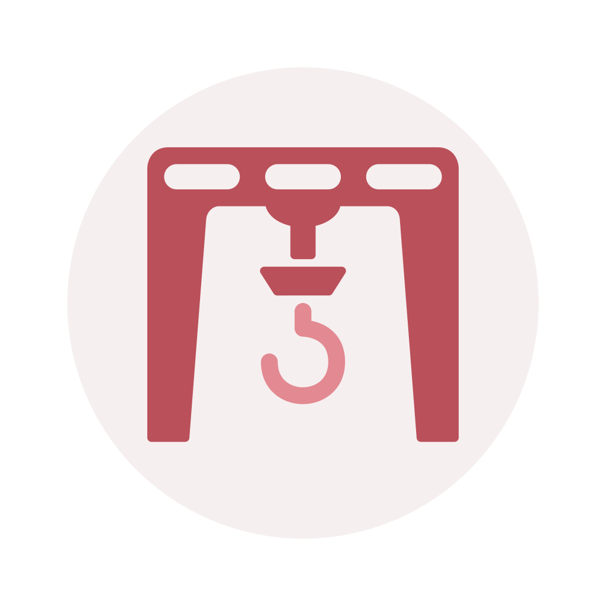

<p align="center">

</p>
<h1 align="center">Gantry</h1>

[Gantry](https://demizo.github.io/Gantry/) is a framework for bootstrapping embedded applications using the [Zephyr RTOS](https://zephyrproject.org/). The architecture is event-driven and data-centric. Applications are made up of composable modules that communicate with each other via events. Modules can define custom event types and payloads, but the core event structure is universal such that any module can parse any event.

The system state, configuration, and device information is all managed by a central data storage module, the Stow. Modules, as well as connected devices, can subscribe to, set, and get items in the Stow. This data-centric approach makes it trivial for modules or devices to react to events and communicate with each other. It avoids common pitfalls where many modules define similar events or pass state via arbitrary event payloads.

**What's included:**

| Component | Description |
| --- | --- |
| Stow | Central data store for device information, state, and configuration. Modules and external clients can set, get, and subscribe to items in the Stow. |
| Memory Management | Configurable reference-counted memory pools. |
| Events | Universal event format for inter-process communications. |
| Modules | Composable application modules. |
| Resource Checker | Static analysis for memory and resource leaks. |
| Flags | State flags for managing and monitoring module state. |

## Integration Quick Start

The project is meant to be included as a West module within a West workspace.

1. Include the module's repository in your West manifest then run ``west update``.
2. Define a ``stow.yaml`` in your applications root directory.
3. Enable the desired Gantry features in your project's ``prj.conf``.
4. Build our application and begin making use of the Gantry library.

The ``samples`` folder provides an example application using the Gantry library. [Gantry Bridge](https://github.com/Demizo/Gantry_Bridge) can be used to interact with the sample app. 

## Project Structure

The project is meant to be included as a West module within a West workspace.

- ``docs`` contains project documentation.
- ``include`` and ``lib`` contain the headers and source for the Gantry library, respectively.
- ``samples`` contains example applications using the Gantry library.
- ``tests`` contains a suite of unit tests.
- ``tools`` contains useful Python utilities, code generation, and analysis tools.
- ``python`` contains an example implementation of a Stow client.

## Setup

### Prerequisites

- [Nix](https://nixos.org/download) with flakes enabled
- If you prefer not to use Nix, review the dependencies within the `shell.nix` file and install them on your system.
- Additionally, a Docker container of the environment can be built using `just docker-build`. This container can be leveraged to use the development environment on systems without the necessary dependencies.

### Enter the development shell

```sh
nix develop
```

> Alternatively, with `direnv` installed, run `direnv allow` to automatically enabled the environment when entering the project folder.

### Initialize the workspace

```sh
just init
```

## Development

```sh
just build   # Build the example app for the nRF52840 DK
just flash   # Flash it with probe-rs
just fix     # Apply the formatters and the copyright header
just check   # Check headers, formatting, lint, leaks, cppcheck and vectors
just test    # Run every test suite that needs no hardware
```

The example app supports the nRF52840 DK (default) and the nRF54L15 DK. Pick another board with `just board=<board> build`, see the [example app's README](samples/example_app/README.md) for each board's target and serial port.

Run `just` to list every command.

The hardware recipes use [probe-rs](https://probe.rs). Install probe-rs's [udev rules](https://probe.rs/docs/getting-started/probe-setup/#linux-udev-rules) to reach the probe without root.

## Documentation

The documentation is available at [demizo.github.io/Gantry/](https://demizo.github.io/Gantry/).

## License

Gantry is licensed under the Apache 2.0 license, see the ``LICENSE`` file for the full license text.
